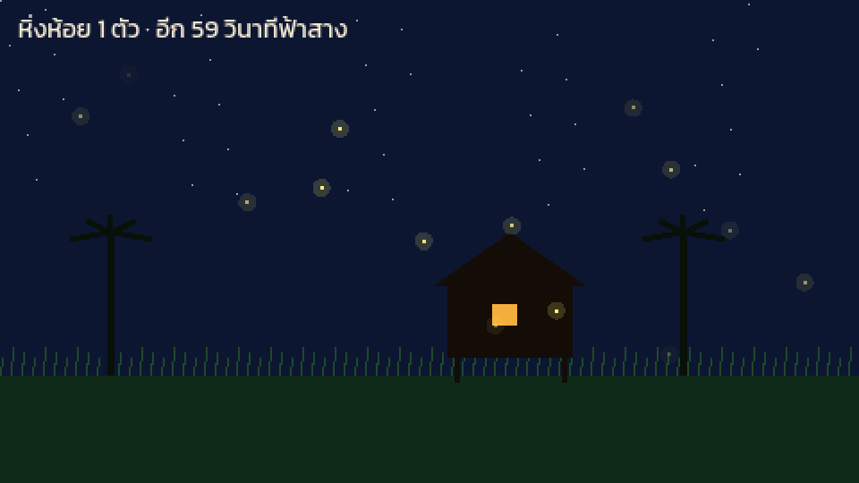

<!-- easy-suite:header:start -->
<!-- easy-suite:header:end -->

# Easy Ship

**ส่งเกมขึ้นเว็บ วินโดวส์ ลินุกซ์ แอนดรอยด์ · itch.io · dry run ก่อนเสมอ**  
One command from a Godot 4.3+ project or a PixiJS v8 game folder to files you can hand to players: a **doctor**
that says what this machine can build (Godot, export templates, Java, Android SDK, butler, itch.io login), a **plan**
with every exact command, **builds** for web, Windows, Linux and Android, **checks** against itch.io's HTML limits and
for leaked secrets, reproducible **zips** with SHA-256s, and the **butler** commands to publish. Nothing is built
unless you add `--build`, and nothing is uploaded unless you add `--upload` — the web editor and the MCP server can't
upload at all. CLI, web dashboard and MCP server; no secrets in config files.

<p align="center"></p>

| Godot web build running in Chrome (served like itch.io: no COOP/COEP) | PixiJS web build (pixi.min.js vendored) |
|---|---|
|  |  |

## Quick start

```bash
npm install
npx tsx src/cli.ts init --workspace ~/ship              # ships/ + games/ (the firefly sample, Godot and PixiJS)
npx tsx src/cli.ts doctor --workspace ~/ship
npx tsx src/cli.ts ship firefly_godot --workspace ~/ship                 # DRY RUN: the plan, nothing written
EASYSHIP_GODOT=~/bin/godot npx tsx src/cli.ts ship firefly_godot --build --workspace ~/ship
npx tsx src/cli.ts ship firefly_godot --upload --workspace ~/ship        # only after butler login + your itch user
npx tsx src/cli.ts serve --workspace ~/ship             # dashboard on http://127.0.0.1:8978
```

Other commands: `info`, `check [id]`, `plan <id> [--targets web,linux] [--json]`, `report <id>`, `clean <id>`,
`new <id> --source games/x --th … --en … [--itch user/game]`, `bump <id> [patch|minor|major]`.

## The sample

`init` copies **หิ่งห้อย · Firefly Night** twice — a Godot 4.3 project and the same game in PixiJS v8 — catch
fireflies over the rice field before dawn, Thai / English HUD (Kanit). `ships/firefly_godot.easyship.json` targets web,
Windows, Linux and Android; `ships/firefly_pixi.easyship.json` targets the web. Both point at a placeholder itch.io
user, so uploads stay disabled until you put yours in.

## What a ship does

| Step | Godot | PixiJS |
|---|---|---|
| prepare | first import if `.godot/` is missing; adds `Easy Ship · Web/Windows/Linux/Android` presets to `export_presets.cfg` (your own presets are kept and renumbered; a one-time backup `export_presets.cfg.easyship.bak`) | copies the folder, skipping `.git`, `node_modules`, `.env*`, keystores, `export_credentials.cfg`, `butler_creds` and your `exclude` globs; vendors `pixi.min.js` (from `EASYSHIP_PIXI` or the workspace's `node_modules/pixi.js`) so the game works offline |
| build | `godot --headless --export-release "Easy Ship · <Target>" <out>` — web is single-threaded by default (runs on itch.io without SharedArrayBuffer headers), Windows / Linux embed the `.pck` (one file), Android is a debug-signed arm64 APK unless `android.release` + a keystore | — |
| check | web: `index.html` at the root, ≤ 1000 files, no file over 200 MB, ≤ 500 MB extracted, local references resolve, no absolute paths, `.wasm` + `.pck`; Windows: PE; Linux: ELF + executable bit; Android: manifest, dex, signature; every target: no secret-looking files or private keys | same web checks |
| package | `releases/<id>/<version>/<id>-<version>-<target>.zip` (deterministic, Unix modes kept) or the APK; `SHIP.md` + `ship-report.json` with sizes and SHA-256 | same |
| upload | only with `--upload`: `butler push <zip> <user>/<game>:<channel> --userversion <version>` (channels `html5`, `windows`, `linux`, `android`) | same |

macOS and iOS are not covered (they need Apple signing and notarisation). PixiJS games ship to the web only; wrap the
web build with Tauri / Electron or Capacitor for desktop or Android.

## Secrets

Easy Ship never reads or prints credentials. `check` refuses config keys that look like secrets (`apiKey`, `token`,
`password`, …) without echoing their values. butler uses its own login (`butler login`) or `BUTLER_API_KEY` from your
shell; release keystores take `android.keystore {path, alias}` from the config and the password from
`EASYSHIP_KEYSTORE_PASSWORD`, passed to Godot as `GODOT_ANDROID_KEYSTORE_RELEASE_*` for that one process. The doctor
reports only whether a login exists. `init` writes a `.gitignore` for `releases/`, `.env*` and keystores.

## Web dashboard

Games, the doctor, each target's plan with its exact commands and blockers, a local **Build** button, the last
report's checks and SHA-256s, the butler commands to copy, and a small config form. There is no upload button.

## MCP server

`npm run mcp` (stdio) or `npm run mcp:http` (port 8979). Tools: `workspace_info`, `doctor`, `check_games`,
`write_game`, `plan_ship`, `build_game` (local), `read_report`. No upload tool. See [docs/MCP.md](docs/MCP.md).

## Ports

| | Port |
|---|---|
| Web dashboard / API | 8978 |
| MCP Streamable HTTP | 8979 |
| Vite dev UI | 5197 |

Everything binds to 127.0.0.1; a non-loopback `--host` needs the printed token.

## Development

```bash
npm test                                                  # vitest (no Godot needed)
GODOT=/path/to/godot npx vitest run test/godot.test.ts    # real web / Windows / Linux exports + runs the Linux build
npm run typecheck
npm run smoke                                             # CLI + MCP (stdio and HTTP)
npm run check:web -- releases/<id>/<version>/web shot.png # headless Chrome: Godot or PixiJS build runs
```

<!-- easy-suite:table:start -->
<!-- easy-suite:table:end -->

## Credits

Sample games written for Easy Suite; Kanit font SIL OFL 1.1. See [CREDITS.md](CREDITS.md). Code: MIT.
