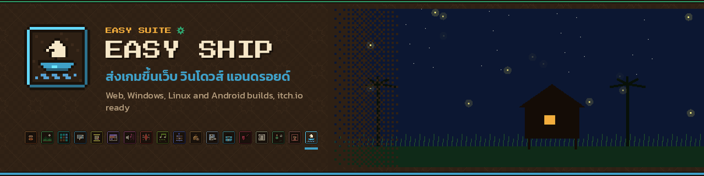
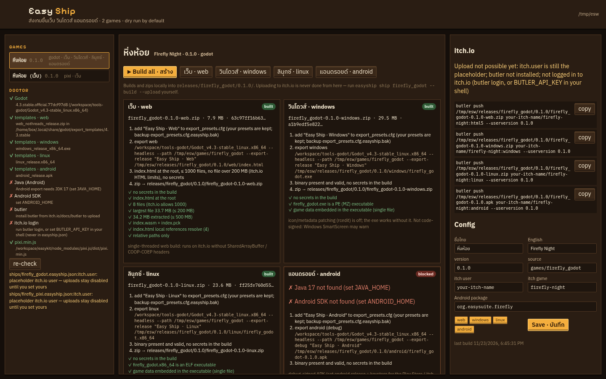
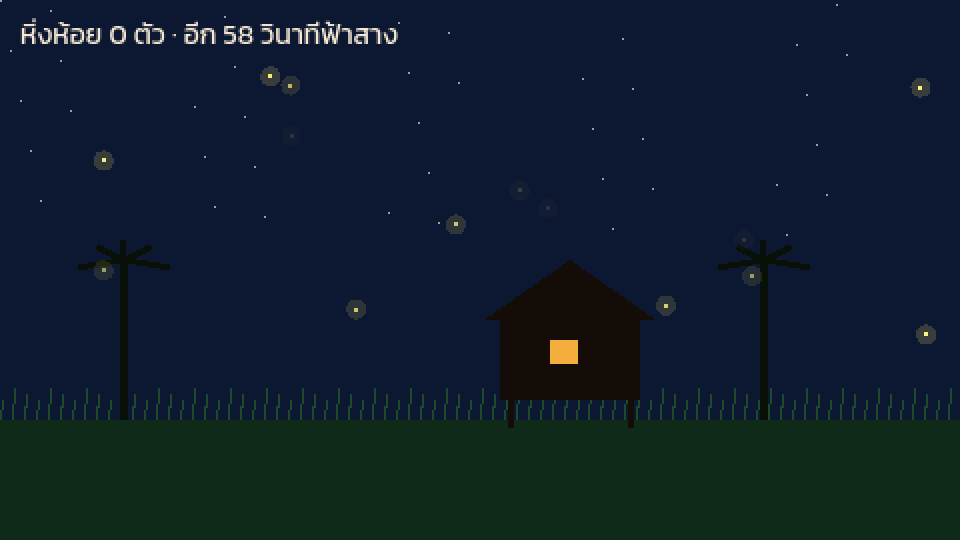

<!-- easy-suite:header:start -->
<p align="center">
  <a href="#easy-suite"></a>
</p>

<p align="center">
  <b>Easy Ship</b> · ส่งเกมขึ้นเว็บ วินโดวส์ แอนดรอยด์ · Web, Windows, Linux and Android builds, itch.io ready<br />
  <sub>Part of <a href="#easy-suite"><b>Easy Suite</b></a>: Thai-friendly pixel-art game dev tools for Godot 4.3+ and PixiJS v8</sub>
</p>

<p align="center">
  <a href="https://github.com/Saladin2020/easyship/actions/workflows/ci.yml"></a> <a href="LICENSE"></a>   <a href="docs/MCP.md"></a> 
</p>

<p align="center">
  <a href="https://github.com/Saladin2020/easysprite"></a>
  <a href="https://github.com/Saladin2020/easyscene"></a>
  <a href="https://github.com/Saladin2020/easytilemap"></a>
  <a href="https://github.com/Saladin2020/easydialogue"></a>
  <a href="https://github.com/Saladin2020/easyquest"></a>
  <a href="https://github.com/Saladin2020/easyui"></a>
  <a href="https://github.com/Saladin2020/easysfx"></a>
  <a href="https://github.com/Saladin2020/easyfx"></a>
  <a href="https://github.com/Saladin2020/easymusic"></a>
  <a href="https://github.com/Saladin2020/easyanim"></a>
  <a href="https://github.com/Saladin2020/easyitems"></a>
  <a href="https://github.com/Saladin2020/easysave"></a>
  <a href="https://github.com/Saladin2020/easykit"></a>
  <a href="https://github.com/Saladin2020/easybattle"></a>
  <a href="https://github.com/Saladin2020/easyfont"></a>
  <a href="https://github.com/Saladin2020/easynpc"></a>
  <a href="https://github.com/Saladin2020/easyportrait"></a>
  <a href="https://github.com/Saladin2020/easyship"></a>
</p>
<!-- easy-suite:header:end -->

# Easy Ship

**ส่งเกมขึ้นเว็บ วินโดวส์ ลินุกซ์ แอนดรอยด์ · itch.io · dry run ก่อนเสมอ**  
One command from a Godot 4.3+ project or a PixiJS v8 game folder to files you can hand to players: a **doctor**
that says what this machine can build (Godot, export templates, Java, Android SDK, butler, itch.io login), a **plan**
with every exact command, **builds** for web, Windows, Linux and Android, **checks** against itch.io's HTML limits and
for leaked secrets, reproducible **zips** with SHA-256s, and the **butler** commands to publish. Nothing is built
unless you add `--build`, and nothing is uploaded unless you add `--upload` — the web editor and the MCP server can't
upload at all. CLI, web dashboard and MCP server; no secrets in config files.

<p align="center"></p>

| Godot web build running in Chrome (served like itch.io: no COOP/COEP) | PixiJS web build (pixi.min.js vendored) |
|---|---|
|  |  |

## Quick start

```bash
npm install
npx tsx src/cli.ts init --workspace ~/ship              # ships/ + games/ (the firefly sample, Godot and PixiJS)
npx tsx src/cli.ts doctor --workspace ~/ship
npx tsx src/cli.ts ship firefly_godot --workspace ~/ship                 # DRY RUN: the plan, nothing written
EASYSHIP_GODOT=~/bin/godot npx tsx src/cli.ts ship firefly_godot --build --workspace ~/ship
npx tsx src/cli.ts ship firefly_godot --upload --workspace ~/ship        # only after butler login + your itch user
npx tsx src/cli.ts serve --workspace ~/ship             # dashboard on http://127.0.0.1:8978
```

Other commands: `info`, `check [id]`, `plan <id> [--targets web,linux] [--json]`, `report <id>`, `clean <id>`,
`new <id> --source games/x --th … --en … [--itch user/game]`, `bump <id> [patch|minor|major]`.

## The sample

`init` copies **หิ่งห้อย · Firefly Night** twice — a Godot 4.3 project and the same game in PixiJS v8 — catch
fireflies over the rice field before dawn, Thai / English HUD (Kanit). `ships/firefly_godot.easyship.json` targets web,
Windows, Linux and Android; `ships/firefly_pixi.easyship.json` targets the web. Both point at a placeholder itch.io
user, so uploads stay disabled until you put yours in.

## What a ship does

| Step | Godot | PixiJS |
|---|---|---|
| prepare | first import if `.godot/` is missing; adds `Easy Ship · Web/Windows/Linux/Android` presets to `export_presets.cfg` (your own presets are kept and renumbered; a one-time backup `export_presets.cfg.easyship.bak`) | copies the folder, skipping `.git`, `node_modules`, `.env*`, keystores, `export_credentials.cfg`, `butler_creds` and your `exclude` globs; vendors `pixi.min.js` (from `EASYSHIP_PIXI` or the workspace's `node_modules/pixi.js`) so the game works offline |
| build | `godot --headless --export-release "Easy Ship · <Target>" <out>` — web is single-threaded by default (runs on itch.io without SharedArrayBuffer headers), Windows / Linux embed the `.pck` (one file), Android is a debug-signed arm64 APK unless `android.release` + a keystore | — |
| check | web: `index.html` at the root, ≤ 1000 files, no file over 200 MB, ≤ 500 MB extracted, local references resolve, no absolute paths, `.wasm` + `.pck`; Windows: PE; Linux: ELF + executable bit; Android: manifest, dex, signature; every target: no secret-looking files or private keys | same web checks |
| package | `releases/<id>/<version>/<id>-<version>-<target>.zip` (deterministic, Unix modes kept) or the APK; `SHIP.md` + `ship-report.json` with sizes and SHA-256 | same |
| upload | only with `--upload`: `butler push <zip> <user>/<game>:<channel> --userversion <version>` (channels `html5`, `windows`, `linux`, `android`) | same |

macOS and iOS are not covered (they need Apple signing and notarisation). PixiJS games ship to the web only; wrap the
web build with Tauri / Electron or Capacitor for desktop or Android.

## Secrets

Easy Ship never reads or prints credentials. `check` refuses config keys that look like secrets (`apiKey`, `token`,
`password`, …) without echoing their values. butler uses its own login (`butler login`) or `BUTLER_API_KEY` from your
shell; release keystores take `android.keystore {path, alias}` from the config and the password from
`EASYSHIP_KEYSTORE_PASSWORD`, passed to Godot as `GODOT_ANDROID_KEYSTORE_RELEASE_*` for that one process. The doctor
reports only whether a login exists. `init` writes a `.gitignore` for `releases/`, `.env*` and keystores.

## Web dashboard

Games, the doctor, each target's plan with its exact commands and blockers, a local **Build** button, the last
report's checks and SHA-256s, the butler commands to copy, and a small config form. There is no upload button.

## MCP server

`npm run mcp` (stdio) or `npm run mcp:http` (port 8979). Tools: `workspace_info`, `doctor`, `check_games`,
`write_game`, `plan_ship`, `build_game` (local), `read_report`. No upload tool. See [docs/MCP.md](docs/MCP.md).

## Ports

| | Port |
|---|---|
| Web dashboard / API | 8978 |
| MCP Streamable HTTP | 8979 |
| Vite dev UI | 5197 |

Everything binds to 127.0.0.1; a non-loopback `--host` needs the printed token.

## Development

```bash
npm test                                                  # vitest (no Godot needed)
GODOT=/path/to/godot npx vitest run test/godot.test.ts    # real web / Windows / Linux exports + runs the Linux build
npm run typecheck
npm run smoke                                             # CLI + MCP (stdio and HTTP)
npm run check:web -- releases/<id>/<version>/web shot.png # headless Chrome: Godot or PixiJS build runs
```

<!-- easy-suite:table:start -->
## Easy Suite


Eighteen small, local-first tools that share one look (teak, lantern gold, Kanit, 16/48px pixels), one
workflow (CLI · web editor · MCP server) and the same targets (**Godot 4.3+** and **PixiJS v8**).
ชุดเครื่องมือทำเกมพิกเซลสไตล์ไทย ใช้ร่วมกันได้ทั้งชุด · the samples share one multicultural southern Thai village.

| | Tool | What it does | Repo |
|:-:|---|---|---|
|  | [**Easy Sprite**](https://github.com/Saladin2020/easysprite) | Compose modular 48px chibi characters (top-down + side-view) and export sheets. | [`easysprite`](https://github.com/Saladin2020/easysprite) |
|  | [**Easy Scene**](https://github.com/Saladin2020/easyscene) | Side-view levels: parallax layers, 16px autotiles, Thai town props. | [`easyscene`](https://github.com/Saladin2020/easyscene) |
|  | [**Easy Tilemap**](https://github.com/Saladin2020/easytilemap) | Top-down 16px maps: blob-47 autotiles, objects, collision, spawns. | [`easytilemap`](https://github.com/Saladin2020/easytilemap) |
|  | [**Easy Dialogue**](https://github.com/Saladin2020/easydialogue) | Branching `.ezd` dialogue with Thai-safe text, portraits and choices. | [`easydialogue`](https://github.com/Saladin2020/easydialogue) |
|  | [**Easy Quest**](https://github.com/Saladin2020/easyquest) | Text `.ezq` quests: steps, flags, items, rewards, linked to dialogue. | [`easyquest`](https://github.com/Saladin2020/easyquest) |
|  | [**Easy UI**](https://github.com/Saladin2020/easyui) | Nine-slice pixel UI kit: panels, bars, inventory, menus, 30 icons. | [`easyui`](https://github.com/Saladin2020/easyui) |
|  | [**Easy SFX**](https://github.com/Saladin2020/easysfx) | Deterministic 8-bit SFX and 4-channel chiptune loops, typing blips. | [`easysfx`](https://github.com/Saladin2020/easysfx) |
|  | [**Easy FX**](https://github.com/Saladin2020/easyfx) | Pixel particles: sparks, fire, rain, lanterns, Raya pelita; sheets + Godot particles. | [`easyfx`](https://github.com/Saladin2020/easyfx) |
|  | [**Easy Music**](https://github.com/Saladin2020/easymusic) | Seeded Thai loop music: ranat, khong wong, saw, khim, pi, kompang; seamless WAV/OGG loops. | [`easymusic`](https://github.com/Saladin2020/easymusic) |
|  | [**Easy Anim**](https://github.com/Saladin2020/easyanim) | Cutscene timelines: actors, camera, dialogue, FX and music cues; Godot + Pixi runners. | [`easyanim`](https://github.com/Saladin2020/easyanim) |
|  | [**Easy Items**](https://github.com/Saladin2020/easyitems) | Item database, shops, inventory, loot tables and crafting; 44 starter items with pixel icons. | [`easyitems`](https://github.com/Saladin2020/easyitems) |
|  | [**Easy Save**](https://github.com/Saladin2020/easysave) | Versioned save slots with migrations and checksums; Thai / English / Malay string tables. | [`easysave`](https://github.com/Saladin2020/easysave) |
|  | [**Easy Kit**](https://github.com/Saladin2020/easykit) | One command drives all 12 tools into a playable Godot 4.3+ and PixiJS game; unified MCP server and `doctor`. | [`easykit`](https://github.com/Saladin2020/easykit) |
|  | [**Easy Battle**](https://github.com/Saladin2020/easybattle) | Turn-based battles: party, bestiary, skills, statuses, bosses; seeded simulator; Godot + Pixi runtimes. | [`easybattle`](https://github.com/Saladin2020/easybattle) |
|  | [**Easy Font**](https://github.com/Saladin2020/easyfont) | Pixel bitmap fonts for Thai, Latin and Malay: stacking vowels and tones, BMFont / TTF for Godot + Pixi. | [`easyfont`](https://github.com/Saladin2020/easyfont) |
|  | [**Easy NPC**](https://github.com/Saladin2020/easynpc) | NPC daily schedules with A* on Easy Tilemap maps, day / night, affinity, dialogue and quest hooks. | [`easynpc`](https://github.com/Saladin2020/easynpc) |
|  | [**Easy Portrait**](https://github.com/Saladin2020/easyportrait) | 64×64 dialogue portraits with 9 emotions, blink and talk frames, from Easy Sprite characters. | [`easyportrait`](https://github.com/Saladin2020/easyportrait) |
|  | **Easy Ship** ← you are here | Toolchain doctor, web / Windows / Linux / Android builds, itch.io zips and butler plans; dry run by default. | [`easyship`](https://github.com/Saladin2020/easyship) |
<!-- easy-suite:table:end -->

## Credits

Sample games written for Easy Suite; Kanit font SIL OFL 1.1. See [CREDITS.md](CREDITS.md). Code: MIT.
